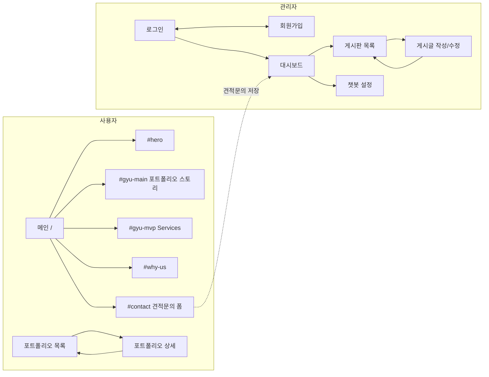

# 화면 설계

퍼블리싱된 9개 화면(`*.html`)을 기준으로 사이트 구조, 화면 흐름, 기능, DB 초안을 정리한다.
PHP 파일 목록은 [page-map.md](../page-map.md).

## 1. 화면 목록 · URL

`.html` 은 퍼블리싱 원본으로 유지하고, 같은 화면을 공통 레이아웃으로 조합한 `.php` 를 따로 둔다.

| 영역 | 화면 | 퍼블리싱 원본 | PHP |
| --- | --- | --- | --- |
| 사용자 | 메인 (원페이지) | `index.html` | `/index.php` |
| 사용자 | 포트폴리오 목록 | `sub-pages/portfolio-sub.html` | `/portfolio.php` |
| 사용자 | 포트폴리오 상세 | `sub-pages/portfolio-sub-detail.html` | `/portfolio-detail.php` |
| 관리자 | 로그인 | `admin-login.html` | `/admin/login.php` |
| 관리자 | 회원가입 | `admin-signup.html` | `/admin/signup.php` |
| 관리자 | 대시보드 | `admin-dashboard.html` | `/admin/index.php` |
| 관리자 | 게시판 목록 | `admin-board.html` | `/admin/board.php` |
| 관리자 | 게시글 작성/수정 | `admin-post-edit.html` | `/admin/post-edit.php` |
| 관리자 | 챗봇 설정 | `admin-chatbot.html` | `/admin/chatbot.php` |

`source/purple-flux.html` 은 히어로 효과 실험 파일이라 화면에서 제외.

## 2. 사이트맵

## 3. 공통 레이아웃

| 영역 | 구성 | 비고 |
| --- | --- | --- |
| 사용자 | head(폰트·공통 CSS) + header(GNB) + 본문 + footer + 공통 스크립트 | 메인만 로더(`#loader`)와 `body.is-loading` 사용, header 테마 메인 `light` / 서브 `dark` |
| 관리자 | head(Pretendard) + 좌측 메뉴(대시보드·게시판·챗봇 설정·로그아웃) + 본문 | 퍼블리싱에는 관리자 메뉴가 없어 PHP 조합 시 새로 추가 |
| 관리자 인증 | head + 가운데 카드 | 로그인·회원가입은 메뉴 없이 단독 |

GNB / footer 메뉴: Home `#hero`, Portfolio `#gyu-main`, Services `#gyu-mvp`, Why Us `#why-us`, Contact `#contact`.
메인에서는 해시만, 다른 페이지에서는 `/#...` 로 메인 섹션으로 이동한다.

## 4. 화면별 기능

### 사용자

| 화면 | 표시/입력 | 필요한 서버 기능 |
| --- | --- | --- |
| 메인 | 로더 → 히어로 → 포트폴리오 스토리(프로젝트 4개) → Services → Why Us → 견적문의 폼 → footer | 견적문의 저장. 프로젝트를 DB로 관리할지는 미정 |
| 메인 견적문의 폼 | 이름*, 이메일*, 연락처*, 예산, 일정, 회사명, 문의내용*, 개인정보 동의* | `inquiries` INSERT, CSRF, 서버측 필수값 검증 |
| 포트폴리오 목록 | 분류 탭 ALL·MVP·Branding·UI/UX·Front·Detail, 썸네일 그리드, `+` 더보기 | 분류별 목록, 페이지 단위 더보기 |
| 포트폴리오 상세 | 대표 이미지, Overview(제목·설명), CLIENT·TYPE·DATE, 사이트 바로가기, 상세 이미지, 목록으로 | `?id=` 단건 조회 |

### 관리자

| 화면 | 표시/입력 | 필요한 서버 기능 |
| --- | --- | --- |
| 로그인 | 이메일(ID), 비밀번호 / ID 찾기 · 비밀번호 찾기 다이얼로그 | 세션 로그인, 계정 찾기 방식 미정 |
| 회원가입 | ID(중복확인)*, 비밀번호*, 비밀번호 확인*, 이름*, 승인 코드* | ID 중복 확인, 승인 코드 검증 후 관리자 생성 |
| 대시보드 | 월 선택, 챗봇 사용률, 방문자 주간 그래프·합계, 회원 현황(전체·이번 달·오늘·탈퇴율), 최근 견적문의(상태), 최근 게시글(분류 탭) | 방문 집계, 문의/게시글 최근 목록 |
| 게시판 목록 | 게시판 선택, 검색(제목+내용·제목·내용·작성자), 노출된 글만, 체크 일괄 노출/숨김/삭제, 13개/페이지 | 목록·검색·페이지네이션, 일괄 상태 변경 |
| 게시글 작성/수정 | 제목, 노출 여부, 게시판, 내용, 파일첨부 / 취소·임시저장·저장(·삭제) | 저장/수정/삭제, 첨부 업로드, 임시저장 |
| 챗봇 설정 | AI 이름, 안내문구, 아이콘, 테마 색상, 말투(친근·차분·따뜻·간결), 환영 메시지 / 삭제·취소·임시저장·저장 | 설정 1건 저장 |

견적문의 상태: 접수 완료 · 검토 중 · 답변 대기 · 처리 완료 · 반려

현재 퍼블리싱 데이터: 게시판·글작성은 `localStorage`, 대시보드는 JS 더미 데이터.

## 5. DB 초안 (MariaDB, utf8mb4)

| 테이블 | 주요 컬럼 | 사용 화면 |
| --- | --- | --- |
| `admins` | id, login_id(UNIQUE), password_hash, name, created_at, last_login_at | 로그인, 회원가입 |
| `inquiries` | id, name, email, phone, budget, schedule, company, details, status, privacy_agreed_at, created_at | 메인 폼, 대시보드 |
| `posts` | id, board, title, content, is_visible, is_draft, admin_id, views, created_at, updated_at | 게시판, 글작성, 대시보드 |
| `post_files` | id, post_id, original_name, stored_name, size, created_at | 글작성 |
| `portfolios` | id, title, category, client, type, project_date, summary, site_url, thumbnail, hero_image, detail_image, sort_order, is_visible | 포트폴리오 목록/상세 |
| `chatbot_settings` | id, ai_name, guide_text, icon, theme_color, tone, welcome_message, is_draft, updated_at | 챗봇 설정, 대시보드 |
| `visit_stats` | visit_date(PK), visitors | 대시보드 방문자 |

테이블은 기능 구현 시점에 `db/schema.sql` 로 확정한다.

## 6. 미정 사항

| 항목 | 내용 |
| --- | --- |
| 게시판 분류 | 게시판 목록·글작성은 `공지사항/이벤트/자료실`, 대시보드 최근 게시글은 `공지사항/프로젝트/디자인/개발/운영` — 하나로 통일 필요 |
| 대시보드 회원 현황 | 사용자 회원가입 화면이 없음. 관리자 계정 수인지, 별도 회원 기능인지 결정 필요 |
| 챗봇 사용률 | 사용자 화면에 챗봇 UI가 없음. 측정 기준(방문자 대비 대화 시작 등) 필요 |
| 포트폴리오 진입 경로 | 메인 GNB Portfolio 는 `#gyu-main` 섹션으로 이동. 목록 페이지로 가는 버튼 위치 결정 필요 |
| 포트폴리오 관리 | 관리자에 포트폴리오 등록 화면이 없음. 게시판으로 관리할지 별도 화면을 만들지 결정 필요 |
| 계정 찾기 | ID/비밀번호 찾기 방식(메일 발송 등). 카페24 메일 발송 가능 여부 확인 필요 |
| 승인 코드 | 고정 코드(설정 파일)인지, 관리자가 발급하는지 |
| 견적문의 상세 | 대시보드에 목록만 있음. 상세 보기·상태 변경 화면 필요 여부 |
