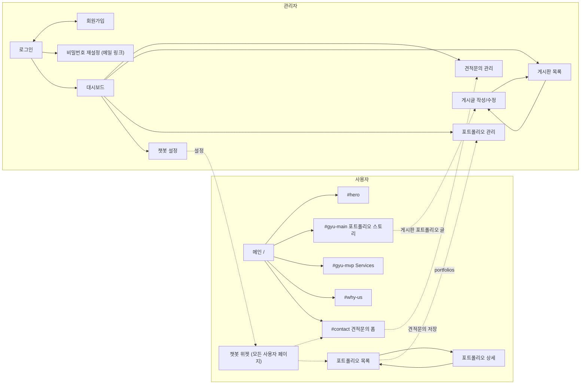

# 화면 설계

퍼블리싱된 9개 화면(`*.html`)을 기준으로 사이트 구조, 화면 흐름, 기능, DB 초안을 정리한다.
PHP 파일 목록은 [page-map.md](../page-map.md).

## 1. 화면 목록 · URL

`.html` 은 퍼블리싱 원본으로 유지하고, 같은 화면을 공통 레이아웃으로 조합한 `.php` 를 따로 둔다.

| 영역 | 화면 | 퍼블리싱 원본 | PHP |
| --- | --- | --- | --- |
| 사용자 | 메인 (원페이지) | `index.html` | `/index.php` |
| 사용자 | 포트폴리오 목록 | `sub-pages/portfolio-sub.html` | `/portfolio.php` |
| 사용자 | 포트폴리오 상세 | `sub-pages/portfolio-sub-detail.html` | `/portfolio-detail.php` |
| 관리자 | 로그인 | `admin-login.html` | `/admin/login.php` |
| 관리자 | 회원가입 | `admin-signup.html` | `/admin/signup.php` |
| 관리자 | 대시보드 | `admin-dashboard.html` | `/admin/index.php` |
| 관리자 | 게시판 목록 | `admin-board.html` | `/admin/board.php` |
| 관리자 | 게시글 작성/수정 | `admin-post-edit.html` | `/admin/post-edit.php` |
| 관리자 | 챗봇 설정 | `admin-chatbot.html` | `/admin/chatbot.php` |
| 관리자 | 견적문의 관리 | 없음 (PHP 로 새로 구성) | `/admin/inquiries.php` |
| 관리자 | 포트폴리오 관리 | 없음 (PHP 로 새로 구성) | `/admin/portfolios.php`, `/admin/portfolio-edit.php` |
| 관리자 | 비밀번호 재설정 | 없음 (로그인 카드 스타일 재사용) | `/admin/reset-password.php` |

`source/purple-flux.html` 은 히어로 효과 실험 파일이라 화면에서 제외.

## 2. 사이트맵

## 3. 공통 레이아웃

| 영역 | 구성 | 비고 |
| --- | --- | --- |
| 사용자 | head(폰트·공통 CSS) + header(GNB) + 본문 + footer + 공통 스크립트 | 메인만 로더(`#loader`)와 `body.is-loading` 사용, header 테마 메인 `light` / 서브 `dark` |
| 관리자 | head(Pretendard) + 좌측 메뉴(대시보드·견적문의·게시판·포트폴리오·챗봇 설정·로그아웃) + 본문 | 퍼블리싱에는 관리자 메뉴가 없어 PHP 조합 시 새로 추가 |
| 관리자 인증 | head + 가운데 카드 | 로그인·회원가입은 메뉴 없이 단독 |

GNB / footer 메뉴: Home `#hero`, Portfolio `#gyu-main`, Services `#gyu-mvp`, Why Us `#why-us`, Contact `#contact`.
메인에서는 해시만, 다른 페이지에서는 `/#...` 로 메인 섹션으로 이동한다.

## 4. 화면별 기능

### 사용자

| 화면 | 표시/입력 | 필요한 서버 기능 |
| --- | --- | --- |
| 메인 | 로더 → 히어로 → 포트폴리오 스토리 → Services → Why Us → 견적문의 폼 → footer | ✅ 포트폴리오 스토리 = 게시판 `포트폴리오` 노출 글(먼저 쓴 글부터, 글 수만큼 슬라이드). 첫 글은 first 디자인, 나머지는 second 디자인 |
| 메인 견적문의 폼 | 이름*, 이메일*, 연락처*, 예산, 일정, 회사명, 문의내용*, 개인정보 동의* | ✅ `/inquiry.php` 로 저장 (CSRF, 서버 검증, honeypot, 세션당 30초 연속 제출 제한). JS 는 fetch 로 제출, JS 없으면 redirect + flash |
| 포트폴리오 목록 | 분류 탭 ALL·MVP·Branding·UI/UX·Front·Detail, 썸네일 그리드, `+` 더보기 | ✅ `portfolios` 노출 글, 6개씩 더보기 |
| 포트폴리오 상세 | 대표 이미지, Overview(제목·설명), CLIENT·TYPE·DATE, 사이트 바로가기, 상세 이미지, 목록으로 | ✅ `?id=` 단건 조회, 값이 없는 항목은 숨김 |
| 챗봇 위젯 | 모든 사용자 페이지 우하단. 이름·안내문구·환영 메시지·빠른 질문, 키워드 응답(견적·포트폴리오·서비스·연락처·인사) | ✅ 퍼블리싱 시안 없음, 새로 구성. 처음 열 때 사용 집계 |

### 관리자

| 화면 | 표시/입력 | 필요한 서버 기능 |
| --- | --- | --- |
| 로그인 | 이메일(ID), 비밀번호 / ID 찾기 · 비밀번호 찾기 다이얼로그 | ✅ 세션 로그인·로그아웃, ID 안내 메일, 비밀번호 재설정 링크 메일(1시간, 1회용) |
| 회원가입 | ID(중복확인)*, 비밀번호*, 비밀번호 확인*, 이름*, 이메일*, 승인 코드* | ✅ ID 중복 확인, 이메일 중복 거부, 승인 코드(`signup_code` 설정) 검증 후 관리자 생성. 이메일 입력은 PHP 화면에만 추가 |
| 대시보드 | 월 선택, 챗봇 사용률, 방문자 주간 그래프·월 합계, 관리자 계정 현황(전체·선택 월 가입·오늘 가입·최근 30일 로그인 비율), 최근 견적문의(상태), 최근 게시글(게시판 탭) | ✅ `dashboard-api.php`. 사용자 회원 기능이 없어 '회원 현황'은 관리자 계정 기준으로 표시 |
| 견적문의 관리 | 상태별 건수, 상태 필터·검색·페이지, 상세, 상태·메모 저장, 삭제 | ✅ 퍼블리싱 시안 없음, 게시판 스타일 재사용 |
| 게시판 목록 | 게시판 선택(공지사항·이벤트·자료실·포트폴리오), 검색(제목+내용·제목·내용·작성자), 노출된 글만, 체크 일괄 노출/숨김/삭제, 13개/페이지 | ✅ DB 목록(`posts-api.php?action=list`, 검색·페이지는 브라우저에서), 일괄 노출/숨김/삭제 |
| 게시글 작성/수정 | 제목, 노출 여부, 게시판, 내용, 파일첨부 / 포트폴리오일 때 상단 문구·배경 이미지 추가 / 취소·임시저장·저장(·삭제) | ✅ 저장/수정/삭제, 첨부·이미지 업로드(`uploads/posts/`). 임시저장은 브라우저(localStorage)에 글 내용만 |
| 포트폴리오 관리 | 표(썸네일·제목·분류·노출·순서), 분류 필터, 일괄 노출/숨김/삭제, 순서 이동 / 등록·수정(이미지 3종) | ✅ 퍼블리싱 시안 없음, 게시판 스타일 재사용 |
| 챗봇 설정 | AI 이름, 안내문구, 아이콘, 테마 색상, 말투(친근·차분·따뜻·간결), 환영 메시지 / 삭제·취소·임시저장·저장 | ✅ 설정 1건 저장(`chatbot-api.php`), 임시저장은 브라우저, 삭제는 기본값 복귀. 아이콘은 PNG/JPEG/WEBP 1MB |

견적문의 상태: 접수 완료 · 검토 중 · 답변 대기 · 처리 완료 · 반려

퍼블리싱 `.html` 원본: 게시판·글작성·챗봇은 `localStorage`, 대시보드는 JS 더미 데이터로 계속 동작. PHP 화면은 모두 DB 사용.

## 5. DB (MariaDB, utf8mb4)

| 테이블 | 주요 컬럼 | 사용 화면 |
| --- | --- | --- |
| `admins` | id, login_id(UNIQUE), password_hash, name, email, created_at, last_login_at | 로그인, 회원가입, 계정 찾기, 대시보드 |
| `password_resets` | id, admin_id, token_hash(UNIQUE), expires_at, used_at, created_at | 비밀번호 재설정 |
| `inquiries` | id, name, email, phone, budget, schedule, company, details, status, admin_memo, privacy_agreed_at, ip, created_at, updated_at | 메인 폼, 견적문의 관리, 대시보드 |
| `posts` | id, board, title, eyebrow, content, image, is_visible, admin_id, views, created_at, updated_at | 게시판, 글작성, 메인 포트폴리오, 대시보드 |
| `post_files` | id, post_id, original_name, stored_name, size, created_at | 글작성 |
| `portfolios` | id, title, category, client, type, project_date, summary, site_url, thumbnail, hero_image, detail_image, sort_order, is_visible, created_at, updated_at | 포트폴리오 목록/상세/관리 |
| `chatbot_settings` | id(=1), ai_name, guide_text, icon, theme_color, tone, welcome_message, updated_at | 챗봇 설정, 챗봇 위젯 |
| `visit_stats` | visit_date(PK), visitors, chatbot_users | 대시보드 방문자·챗봇 사용률 |

전부 `db/schema.sql` 에 반영됨.

## 6. 결정 사항 · 남은 확인

| 항목 | 내용 |
| --- | --- |
| 게시판 분류 | `공지사항/이벤트/자료실/포트폴리오` 로 통일 (`POST_BOARDS`). 대시보드 탭도 같은 목록 |
| 대시보드 회원 현황 | 사용자 회원 기능이 없어 관리자 계정 기준으로 표시. 사용자 회원 기능을 만들면 다시 결정 |
| 챗봇 사용률 | 선택 월 '챗봇을 연 세션 / 방문 세션' (둘 다 세션당 하루 1회) |
| 포트폴리오 진입 경로 | 미정. 메인 GNB Portfolio 는 `#gyu-main` 섹션으로 이동하고, 목록 페이지는 챗봇 응답 링크로만 연결됨. 목록 페이지로 가는 버튼 위치 결정 필요 |
| 포트폴리오 데이터 | 메인 슬라이드 = 게시판 `포트폴리오` 글, 목록/상세 = `portfolios` 테이블로 분리 |
| 포트폴리오 시드 | 원본에 상세가 있는 쿠무 외 5개는 분류·소개 문구를 임의로 넣음 (`db/seed-portfolios.sql`). 실제 내용으로 교체 필요 |
| 계정 찾기 메일 | 로컬은 `app/storage/mail.log`. 카페24 `mail()` 발송 여부는 배포 후 확인 필요 |
| 견적문의 알림 | 문의 접수 시 관리자 알림 메일은 보내지 않음. 필요하면 `send_mail()` 로 추가 |
